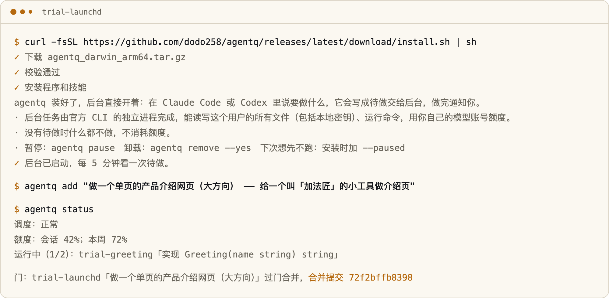
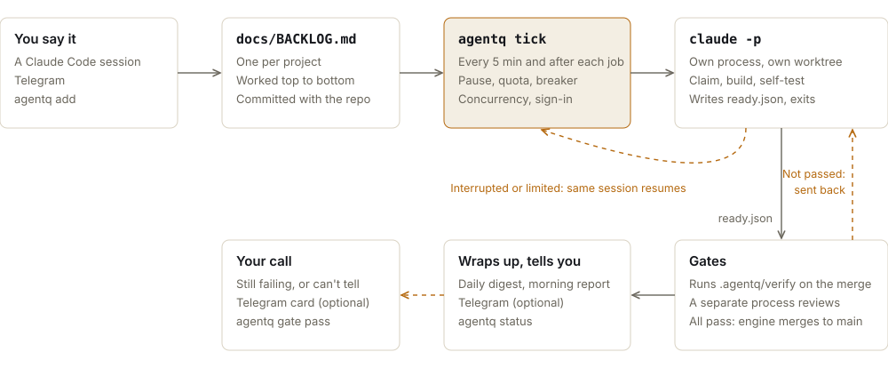
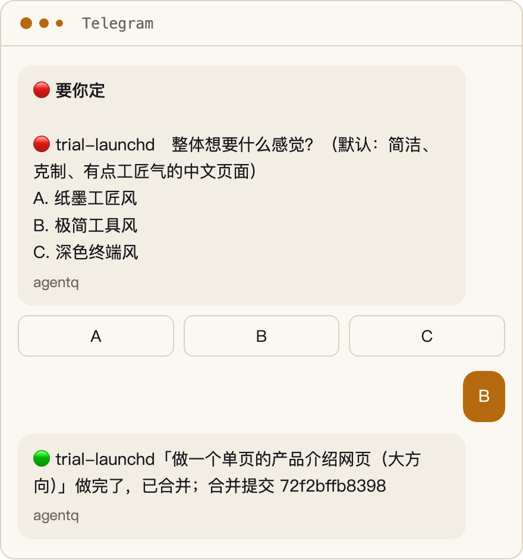

<div align="center">

<picture>
  <source media="(prefers-color-scheme: dark)" srcset="https://raw.githubusercontent.com/dodo258/agentq/main/docs/brand/readme/logo-dark.svg">
  
</picture>

# agentq

agentq is a background task scheduler for Claude Code. It hands the to-do items in each project's `docs/BACKLOG.md` to separate Claude Code processes, then merges the work to the local default branch once tests and a review pass.

[](LICENSE)    
[](https://github.com/dodo258/agentq/releases/latest) [](https://github.com/dodo258/agentq/stargazers)

**[Install](#install)** &nbsp;·&nbsp; **[Install guide](docs/install.en.md)** &nbsp;·&nbsp; **[Support matrix](docs/reference/support-matrix.en.md)** &nbsp;·&nbsp; **[Security](SECURITY.md)** &nbsp;·&nbsp; [简体中文](README.md) · **English**

<br>

<picture>
  <source media="(prefers-color-scheme: dark)" srcset="https://raw.githubusercontent.com/dodo258/agentq/main/docs/brand/readme/hero-dark.png">
  
</picture>

<sub>Command output is in Chinese for now. Items can be written in any language.</sub>

</div>

<br>

## Install

```sh
curl -fsSL https://github.com/dodo258/agentq/releases/latest/download/install.sh | sh
```

The script downloads a prebuilt binary and checks its SHA256. It needs Git, but not sudo or Go. Running the same command on an existing install upgrades it and keeps your configuration and task data.


Once installed, it is running. There is no extra prompt: installing is the consent. At the end the program tells you three things, plus how to pause and remove it:

- Background tasks can read and write every file your OS user can, and run commands.
- Task content goes to the model service you use, on your own quota.
- With nothing to do, no quota is used.

To install without running it yet, add `--paused` (`curl ... | sh -s -- --paused`). Rerunning the command on an existing install is an upgrade: your switches are kept, and a paused install stays paused.

If the Claude Code CLI is missing or signed out, the script runs the official installer and `claude auth login` when it has a terminal. Without a terminal it prints the commands; once the CLI works, say what you want in a chat and the background starts by itself. The desktop app can't run background tasks, so the CLI is needed even if the app is installed.

The install includes the program, the skills for the task workflow and review, project templates and a set of general engineering rules. Existing configuration is not changed. Behind a firewall, add `--proxy <url>` or `--mirror <prefix>`; with a mirror, the checksum file and source still come from the original address. Remove it with `agentq remove --yes`, which keeps your data. For other install routes and options, see the [install guide](docs/install.en.md).

To have an agent install it, send it this line:

> Read `https://github.com/dodo258/agentq/blob/main/llms.txt` and install agentq for me

## Usage

Install, then just say it. Open Claude Code or Codex (CLI or desktop app) in your project and say what you want done:

```text
Retry an export 3 times when it fails, and show the retries in a log when offline
```

No trigger word and no agentq commands. The `dispatch` skill decides: a new feature, a bug fix or a UI change, however small, becomes an item with acceptance criteria in `docs/BACKLOG.md`, goes to the background, and you are notified when it is done. A question, a trivial edit such as a typo or a wording change, or "just change it" / "I'm watching" is done right there in the chat.

- The folder doesn't have to be under `~/projects`, be a Git repository or have a BACKLOG: the skill runs `git init` (committing the existing files, with a `.gitignore` that keeps out secrets and dependencies), adds the files and registers it in `extra_projects`. In places that don't look like a project, such as your home folder or Desktop, it asks once for a name and location, with a default.
- If the background isn't running (removed, or not loaded after a reboot), the skill starts it. A pause you set yourself is left alone.
- Progress, review and stopping are chat too: "how is it going", "how do I check what's done", "stop for now".

You can also work from the terminal:

```sh
agentq add "..."                  # add an item to this project's queue; the first one brings the project in
agentq run my-app                 # start one of the project's items now
agentq new "..."                  # create a new project and build its first version from one line
agentq discuss                    # list the direction questions waiting for your answer

agentq status                     # quota, running tasks, each project's queue, recently finished tasks
agentq logs 1105-211629-shop-api  # one task's full result
agentq stop 1105-211629-shop-api  # stop a task and keep its changes
agentq pause                      # stop starting new tasks; agentq resume undoes it
agentq doctor                     # read-only check of install, CLI and config
agentq update                     # upgrade to the latest release
```

Every command is listed in the [command reference](docs/reference/commands.md) (in Chinese).

## How it works

agentq picks items, starts and monitors processes, runs the quality gates, merges and keeps records. It writes no product code. Claude Code does the implementation and self-testing, following the bundled `agent-task` skill, and a separate Claude Code process does the review.

<picture>
  <source media="(prefers-color-scheme: dark)" srcset="https://raw.githubusercontent.com/dodo258/agentq/main/docs/brand/readme/flow-en-dark.svg">
  
</picture>

The scheduler runs every 5 minutes and again whenever a task ends, so a queued item starts within seconds. By default 2 tasks run at once, with at most 1 per project. Tasks don't depend on a terminal or client, but the machine has to stay on.

The scheduler never runs `git push`. Merges happen on the local default branch, and pushing to a remote needs separate authorization. Full rules: [scheduling](docs/reference/scheduling.md) (in Chinese).

## Quality gates

A task can only get its branch ready to merge and write `.agentq/ready.json`. agentq decides whether to merge using the five gates below, which run on the branch merged with the latest default branch.

| Gate | When it runs | What it checks | Default level |
| :-- | :-- | :-- | :-- |
| **Test** | Every time | Runs the project's `.agentq/verify` | Blocks the merge |
| **Review** | Skipped for markdown-only changes | A separate process reviews the change. A blocking finding needs a file, line, evidence and reproduction steps | Blocks the merge |
| **Patch** | When the change is a fix | A third fix to the same module within 30 days. Set to `error`, it sends the task back to rewrite that module | Records only |
| **UI** | When UI files change | A project script takes screenshots, agentq checks they aren't blank, and a review process blocks only on broken rendering, overflow, unreadable text or placeholder content | Records only |
| **Product** | On the first version from `agentq new` and items marked `（成品）` | Runs the project's smoke test `.agentq/smoke` and produces a handoff sheet if it passes | Records only |

A project can change the levels in `.agentq/gates.json`. On the first `agentq init` or `agentq add`, the program generates `.agentq/verify` from the project's files. If it can't tell what to run, the task has to add the script while implementing.

When a gate fails, the reason goes back to the task and the same session continues, for at most 2 rounds. If it still fails or the result can't be determined (for example, the script reports it can't run this time), the item is marked stuck and waits for you:

```sh
agentq gate report <job id>                # see why
agentq gate pass <job id> --reason "..."   # let this one through
agentq gate rerun <job id>                 # run the gates again without code changes
agentq gate abandon <job id>               # give up and keep the branch
```

A task that merges by itself around the gates doesn't count as passed. agentq flags it and notifies you. The gates guard against a model cutting corners or making mistakes. They are not a security boundary, because tasks have full access to your machine.

Direction questions (design, UI, technology choices) get asked once before work starts: at most 3 questions, each with a default answer. When you assign work in a Claude Code session, it asks right there. For items marked `（大方向）` and for `agentq new`, the background sends a Telegram card and goes with the defaults after 2 hours without an answer, and other items don't wait. Without Telegram it uses the defaults immediately.

`agentq health` shows each module's recent changes, fix count and two-week rework rate. `agentq stats` shows how often each gate blocked or passed work, plus first-time satisfaction and rework rates worked out from commit history. Details: [quality gates and engine merge](docs/reference/features.md#质量门和引擎合并) (in Chinese).

## Failure handling

| Situation | Response |
| :-- | :-- |
| **A process exits midway, or the machine reboots** | Checks the BACKLOG and resumes the same session. Merged work isn't redone |
| **A usage limit is hit** | Cools down until the reset time, then resumes the same session |
| **Quota is nearly gone** | Starts no new tasks once the 5-hour window reaches 70% or the weekly quota reaches 90%, leaving the rest for you. `agentq run` is refused at 98% |
| **Tasks fail right after starting** | Three tasks exiting within 3 minutes trip a breaker that stops new starts for 30 minutes. Another failure doubles that, up to 4 hours |
| **A task runs away** | Each run has a budget cap, subagent runaway stops it automatically, and the default timeout is 4 hours. Its changes are kept |
| **The state file breaks** | Unreadable: nothing is wrapped up or started. Corrupt: the bad file is backed up, state is rebuilt from task records, and no new task starts that round |
| **Run data grows** | Task records are kept 90 days, and logs are trimmed |

These paths are covered by a fake CLI and a stress test. A real usage limit has not been run yet. The stress test kills processes, corrupts state files, forces concurrency, fills the disk and jumps the clock, all with fake dependencies, and has only run on macOS so far. Method: [CONTRIBUTING](CONTRIBUTING.md#暴力测试). Rules: [scheduling](docs/reference/scheduling.md) (in Chinese).

## Telegram

<table>
<tr>
<td width="55%">

Telegram is optional. Once it's set up, you can message the bot with requests and screenshots.

- Reply to a "decide" message or tap a button. The decision is written back to the item and the task continues.
- Reply to a task alert to pick that task back up.
- `状态`, `额度`, `暂停` and `恢复` (status, quota, pause, resume) are answered by code and use no quota.

At most 10 notifications go out a day. Messages between 23:00 and 08:00 wait for the morning, and messages of one kind within 30 minutes are combined. A merged task sends its merge commit, and failures, interruptions and stuck items are reported too. Without Telegram, agentq uses local desktop notifications.

Completion notices and decision card buttons work on real Telegram. Reply threads and full conversation round trips have only been tested against a fake service. [Setup](docs/guide/telegram.md) (in Chinese).

</td>
<td width="45%">
<picture>
  <source media="(prefers-color-scheme: dark)" srcset="https://raw.githubusercontent.com/dodo258/agentq/main/docs/brand/readme/telegram-dark.png">
  
</picture>
</td>
</tr>
</table>

## Configuration

The configuration file is `~/.agentq/config.json`. Changes take effect at the next tick with no restart. Common settings are in the [configuration guide](docs/guide/configuration.md), and every key is in the [config reference](docs/reference/config.md) (both in Chinese).

On a new install these features are off and only run once you turn on their switch:

| Feature | Switch | What it does |
| :-- | :-- | :-- |
| **Night shift** | `night_enabled` | Moves the backlog along, triages issues and writes a report at 01:00 every day |
| **Review** | `review_enabled` | Reviews recent commits and failed tasks and writes the morning report at 06:30 every day |
| **Patrol** | `patrol_enabled` | Checks services, backups, stuck tasks, quota and disk every hour, and starts one read-only analysis when something new goes wrong |

## Support

| Item | Status |
| :-- | :-- |
| **Claude Code CLI** | Default backend. 2.1.316 has reached a merge for real on macOS, including the review gate, the UI gate, `agentq new`, the launchd background and assigning work from the desktop app |
| **Codex CLI** | Choose it by hand. codex-cli 0.166.0 has reached a merge and resumed after SIGTERM for real on macOS. Direction questions and patrol analysis do not start on it, and it has no dollar cap |
| **opencode** | Experimental. The real opencode has never been run |
| **macOS** | arm64 is the main platform. amd64 cross-compiles and has not run on an Intel Mac |
| **Linux** | Needs `systemd --user`. amd64 runs the tests and a real systemd acceptance in CI, with no real task run. arm64 cross-compiles |
| **WSL, Windows** | WSL is unverified. Windows is not supported |

Not yet verified for real: a usage limit and an expired token, assigning work from the Codex desktop app, real tasks and stress tests on Linux, and any opencode run. The gates have not been compared with a bare CLI on real projects either. Details for each item are in the [support matrix](docs/reference/support-matrix.en.md).

Pick a backend at install time with `--backend codex` or `--backend opencode` (`... | sh -s -- --backend codex`). The interface for new tools is described in [docs/backends.md](docs/backends.md) (in Chinese). The prebuilt binary needs only Git, and building from source uses only the Go standard library.

The desktop app's Code tab and the CLI read the same rules and skills. Background tasks don't appear in the client's session list, so check results with `agentq status` or notifications.

## Permissions and limits

Unattended coding needs `bypassPermissions`. A task runs as your OS user with all your file permissions, can read local secrets (including App Store Connect private keys and SSH keys), and can run any command. Prompts and deny rules are not a security boundary. agentq guards against a model cutting corners or making mistakes, not against deliberate damage.

On a sensitive machine, run it under a separate OS user or in a container, and keep production credentials off it. Details: [SECURITY](SECURITY.md).

Other limits:

- The machine has to be on. Tasks continue after sleep or a reboot, but nothing runs while it's off.
- Tasks spend your own model quota.
- Command output, notifications and BACKLOG section headings are in Chinese for now (`## 待做` means "to do"). Item text can be in any language. Most guides are in Chinese.

## Privacy

agentq has no telemetry and collects nothing. Task content goes only to the model service you use. Apart from installing and upgrading, agentq itself connects out only for features you turned on: Telegram and GitHub.

## FAQ

- **What work doesn't suit agentq?** Tasks you want to watch and steer as they go. Use Claude Code directly for those.
- **Does it use quota with nothing to do?** No. With an empty queue no model starts. The night shift and patrol analysis only run if you turn them on.
- **My project has its own rules.** Its `CLAUDE.md` and `AGENTS.md` apply as usual. The first time it runs after install, agentq puts a set of general engineering rules in `~/.claude/rules/agentq/`, unless you already have global rules. `agentq env on` adds them and `agentq env off` removes them. Their first line says project rules come first, but that is only a hint, so they hold general engineering habits and nothing project-specific.
- **Which model does it use?** New installs follow the model and effort you picked in the CLI and pass no flags. A model written in an existing config is used as is.
- **Does it push to my remote?** The scheduler doesn't push, and the `agent-task` skill has tasks merge locally only. Pushing needs separate authorization. For tasks this is a skill convention, not a technical limit, because they can use your signed-in `git`. The optional `--backup` service pushes only to private targets listed in `~/.agentq/backup.json`.
- **How do I stop it right now?** `agentq pause` starts no new tasks, and `agentq stop <job id>` stops a running task.
- **How do I remove it?** `agentq remove --yes` takes off the program and services and keeps your data and recovery material. To undo that, see the [install guide](docs/install.en.md).
- **Can an upgrade lose data?** Upgrades are transactional and keep your configuration and task data. `agentq rollback --yes` returns to the previous version.

## Documentation

| Document | What's in it |
| :-- | :-- |
| **[Install guide](docs/install.en.md)** | Candidate self-check, conflicts, transactional backup and rollback |
| **[Support matrix](docs/reference/support-matrix.en.md)** | Verification state of each capability |
| **[Getting started](docs/guide/getting-started.md)** | Install, first task, other routes (in Chinese) |
| **[Configuration guide](docs/guide/configuration.md)** | Project directory, concurrency, models, night shift, optional features (in Chinese) |
| **[Telegram guide](docs/guide/telegram.md)** | Setting up the bot, adding tasks, replying with decisions (in Chinese) |
| **[Daily use](docs/guide/daily-ops.md)** | Status, stop, resume, decisions, morning report (in Chinese) |
| **[Troubleshooting](docs/guide/troubleshooting.md)** | Causes and fixes by symptom (in Chinese) |
| **[Commands](docs/reference/commands.md)** | Every command (in Chinese) |
| **[Config reference](docs/reference/config.md)** | Type, default and effect of each key (in Chinese) |
| **[Scheduling](docs/reference/scheduling.md)** | Picking items, concurrency, quota, breaker, resume, state corruption (in Chinese) |
| **[Features](docs/reference/features.md)** | New projects, quality gates, suggestions, night shift, patrol, notifications (in Chinese) |
| **[Files](docs/reference/files.md)** | Every file under `~/.agentq/` (in Chinese) |

Also: [privacy gate](docs/privacy.md), [legacy install](docs/legacy-install.md), [entry point for agents](llms.txt).

## Contributing

Issues, PRs and usage feedback are welcome. Start with [CONTRIBUTING](CONTRIBUTING.md). Report vulnerabilities as described in [SECURITY](SECURITY.md).

## License

[MIT](LICENSE). Sources, versions and licenses of third-party skills are recorded in [`dependencies/claude.lock.json`](dependencies/claude.lock.json).

agentq is an independent project and is not affiliated with Anthropic.
