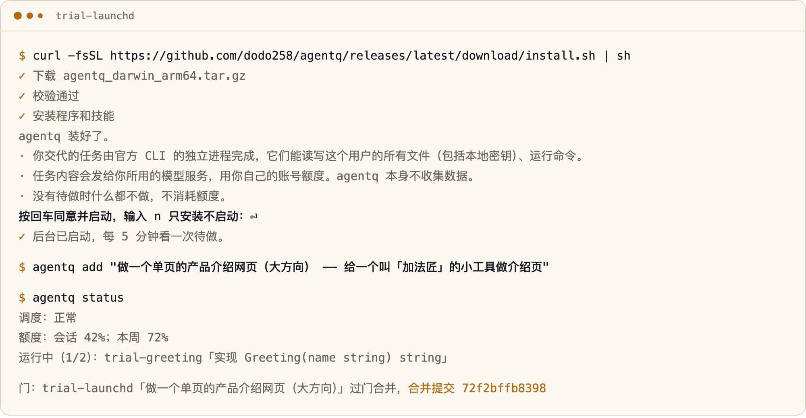
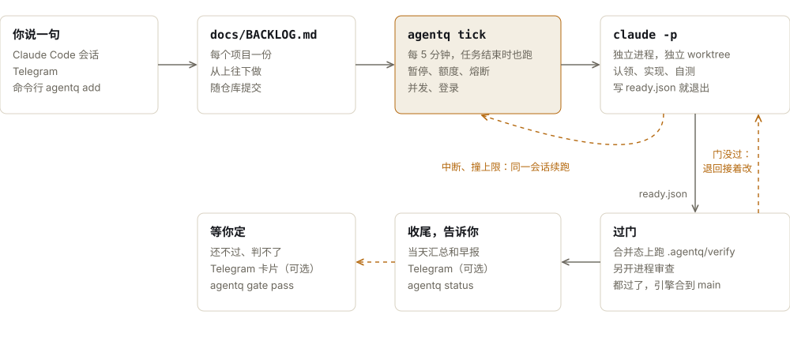
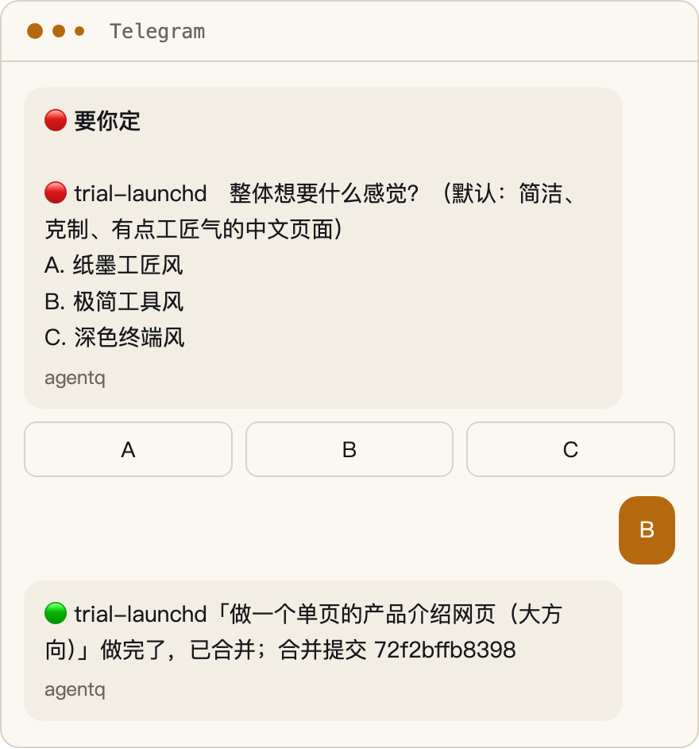

<div align="center">

<picture>
  <source media="(prefers-color-scheme: dark)" srcset="https://raw.githubusercontent.com/dodo258/agentq/main/docs/brand/readme/logo-dark.svg">
  
</picture>

# agentq

### 交代一句，做到合并。

**修 bug、补测试、做新项目的第一版，一条条排进去。**<br>
它开独立的 Claude Code 进程去做，测试和审查过了才由 agentq 合并。中断了续上，额度满了等，做完有记录。

[](LICENSE)    
[](https://github.com/dodo258/agentq/releases/latest) [](https://github.com/dodo258/agentq/stargazers)

**[快速开始](#快速开始)** &nbsp;·&nbsp; **[入门指南](docs/guide/getting-started.md)** &nbsp;·&nbsp; **[命令](docs/reference/commands.md)** &nbsp;·&nbsp; **[安全](SECURITY.md)** &nbsp;·&nbsp; **简体中文** · [English](README.en.md)

<br>

<picture>
  <source media="(prefers-color-scheme: dark)" srcset="https://raw.githubusercontent.com/dodo258/agentq/main/docs/brand/readme/hero-dark.png">
  
</picture>

</div>

<br>

## 适合你吗？

Claude Code 很能干，但它等你开口：一个做完了要你开下一个，中途断了要你发现，撞了上限要你记着回来。agentq 把这些接过去。

- **一条接一条**：每个项目一份 `docs/BACKLOG.md`，上一个任务结束几秒内接下一条。终端和客户端都不用开着。
- **中断了续上**：进程退出、机器重启、撞上用量上限，都用同一个会话接着做，不从头再来。
- **做完要对得上**：任务说做完了不算数。它只做到分支可合并，agentq 在合并后的代码上跑项目的检查脚本（第一次接手时按项目文件生成，判断不了就由任务补），再开独立进程审查，都过了才合到默认分支。没过退回任务，还不过就等你定。
- **一次装齐**：任务流程、审查和收尾的技能随安装带上，还有一份通用工程规则，不用找插件、写规则。你已有全局规则就不加这份（要加：`agentq env on`），你自己的配置不动。

适合手上有不止一个 Git 项目、想把活交出去、过后看结果的人。需要边做边看、频繁对话的任务，直接开 Claude Code 更合适，你不需要它。

## 快速开始

**1 · 安装。**

```sh
curl -fsSL https://github.com/dodo258/agentq/releases/latest/download/install.sh | sh
```

<sub>下载预编译程序并校验 SHA256，不用 sudo，不用装 Go。新老用户同一条命令，重跑就是升级，配置和任务数据都保留。没有 Claude Code CLI 时，同意后替你运行官方安装命令并登录；只装了桌面端也一样。网络不通时用 `--proxy <地址>` 或 `--mirror <前缀>`，校验文件和源码不走镜像，被改过的文件会被拒绝。卸载：`curl … | sh -s -- --uninstall`，或 `agentq remove --yes`，都保留数据。</sub>


也可以告诉你的 agent：

> 读 `https://github.com/dodo258/agentq/blob/main/llms.txt`，帮我装 agentq

**2 · 按一下回车。** 装完它会讲清楚三件事：任务能读写你这个用户的所有文件；任务内容会发给你用的模型服务，用你自己的额度；没有待做时不消耗额度。回车同意并启动，输入 `n` 只安装不启动。没有终端（CI、agent 代装）时只装不启动，不会替你同意。

**3 · 说一句要做什么。** 在项目目录打开 Claude Code，CLI 或桌面端都行：

```text
派活：导出失败时重试 3 次，断网时要能看到重试日志
```

它写成带验收标准的条目，交给后台，你接着干别的。

<sub>项目要是 Git 仓库，默认分支自动认（主目录在 `main` 或 `master` 上就用它，否则看 `origin/HEAD`，再看本地 `main`、`master`）。不用放到 `~/projects` 下。</sub>

或者全在终端里：

```sh
agentq add "..."                  # 一句话排一条，后台会接；第一次顺带把项目接入
agentq run my-app                 # 现在就开始，不等下一轮
agentq new "..."                  # 一句话从零做新项目的第一版
agentq discuss                    # 看开工前在问你的大方向
agentq inbox add "..."            # 不属于任何项目的活：调研、写东西、整理文件

agentq status                     # 额度、运行中、各项目待做、最近结束
agentq logs 1105-211629-shop-api  # 某个任务的结果全文
agentq stop 1105-211629-shop-api  # 停掉一个任务，成果留着
agentq pause                      # 暂停接活；agentq resume 恢复
agentq doctor                     # 只读检查安装、CLI 和配置
agentq update                     # 升级到最新版
```

## 支持什么

- **工具**：Claude Code，后台任务走官方 CLI，用的是你自己的账号。Codex CLI 也能当后端：在 macOS 上用 ChatGPT 登录真实跑通过一次到合并的闭环和中断续跑，要工具限制的任务（Router、闲时找活、主动感知、发版准备）在它上面不启动，没有美元上限。opencode 是实验：真实的 opencode 没跑过，只用假 CLI 测过。安装时加 `--backend codex` 或 `--backend opencode`（`... | sh -s -- --backend codex`），[接新工具的接口](docs/backends.md)已留好。
- **客户端**：Claude 桌面端的 Code 标签页和 CLI 读同一份规则和技能，在里面说一句就能派活。派出去的任务跑在后台，不显示在客户端的会话列表里，用 `agentq status` 或推送看结果。
- **系统**：macOS（launchd）、带 `systemd --user` 的 Linux。Windows 不支持，WSL 没验证过。
- **依赖**：Git。预编译程序没有别的依赖，源码构建只用 Go 标准库。

每项验证到了哪一步，见[支持矩阵](docs/reference/support-matrix.md)。

## 它怎么工作

agentq 自己不写业务代码。挑活、启动、看着、过门、合并、收尾、记账是它的事；实现和自测由 Claude Code 按随附的 `agent-task` 技能完成，审查由另开的 Claude Code 进程做。

<picture>
  <source media="(prefers-color-scheme: dark)" srcset="https://raw.githubusercontent.com/dodo258/agentq/main/docs/brand/readme/flow-zh-dark.svg">
  
</picture>

agentq 不做 `git push`，推送远程要你另外授权。完整规则见[调度规则](docs/reference/scheduling.md)。

## 它做什么

### 无人值守不等于没人管

无人值守最怕的是半夜出了事没人知道，或者同一个错误把待办烧光。这些情况都写了处理办法，也都有测试。

| 出了什么事 | 怎么处理 |
| :-- | :-- |
| **进程中途退出** | 核对 BACKLOG 后用同一会话续跑，已经合并的不重做 |
| **撞上用量上限** | 冷却到重置时间，再接着做 |
| **额度快用完** | 到 90% 不领新活，手动启动到 98% 也拒绝 |
| **一启动就报错** | 连续 3 个任务 3 分钟内退出就熔断，冷却从 30 分钟起，不把待办烧光 |
| **任务失控** | 单次预算兜底，子代理失控自动停，超时默认 4 小时，成果都留着 |
| **状态文件坏了** | 读不了就不收尾也不启动；内容损坏就备份坏文件，按任务记录重建，那次不启动新任务 |
| **磁盘** | 任务记录默认留 90 天，日志定期清理 |

<sub>暴力测试会杀进程、写坏状态文件、制造并发、写满磁盘、跳变时钟，全部用假依赖，最近一次在 macOS 上 3 个种子各 40 轮没有失败。Linux 上跑过全部单元测试和真实的 `systemd --user` 流程，暴力测试还没跑过。方法见 [CONTRIBUTING](CONTRIBUTING.md#暴力测试)。</sub>

### 做完要对得上

任务说「做完了」只是它的说法。它只能把分支做到可合并，写一份 `.agentq/ready.json`，合不合并由 agentq 判定：

- **测试门**：把任务分支和最新的默认分支合起来，在一次性 worktree 里跑项目的 `.agentq/verify`。
- **审查门**：另开一个进程审查这次改动，阻塞要拿得出证据。
- **补丁门**：看 git 历史，同一个模块 30 天内第三次修复记下来。调成 `error` 就退回，合同改成重写这个模块。
- **界面门**：改到界面文件才跑。项目脚本截图，引擎查不是空白，再交给审查进程。只有渲染坏、溢出、看不清、占位内容这类有证据的问题能阻塞，好不好看只给意见。
- **成品门**：`agentq new` 的第一版和标了 `（成品）` 的条目才跑。项目的烟测过了才有交付单，写明做了什么、怎么打开看。
- 都过了，引擎合到默认分支，再写「已完成」和交接单。

测试门和审查门默认挡合并，另外三道默认只记录，项目可以在 `.agentq/gates.json` 调。`agentq health` 看每个模块最近的改动、修复次数和两周返工率，`agentq stats` 看每道门挡了多少、放行了几次。

设计、界面、前后端选型这类大方向，开工前问你一次：最多 3 个问题，每个带默认答案，细节不问。在会话里派活就当场问；后台走 Telegram 卡片，等 2 小时没回按默认，别的条目不等。

没过就把原因退回任务，同一会话接着改。还不过，或者判不了（比如脚本说这次跑不了），就标卡住等你定：`agentq gate report` 看原因，`agentq gate pass` 放行，`agentq gate rerun` 再审一次。任务绕过门自己合并的不算过门，会标出来。门防的是偷懒和误操作，不是安全边界：任务在你的机器上有完整权限。`agentq quality` 按提交记录算一次满意率和返工率，每一条都能查到依据。

### 手机上派活和决定

<table>
<tr>
<td width="55%">

配好 Telegram（可选）后，直接给机器人发需求，也可以带截图。

- 回复「要你定」的消息，或者点按钮，它写回条目接着做
- 回复任务的提醒，接上那个任务
- 发 `状态`、`额度`、`暂停`、`恢复`，由代码直接回，不花额度
- 一句话做新项目：`一个记录读书笔记的网页工具`，做完把项目路径和合并提交推给你

每天最多推 10 条，23:00 到 08:00 只攒着，同类 30 分钟合并一次。任务合并后推一条，带合并提交；失败、中断、卡住也说。没配 Telegram 就弹本机通知。[配置方法](docs/guide/telegram.md)。

</td>
<td width="45%">
<picture>
  <source media="(prefers-color-scheme: dark)" srcset="https://raw.githubusercontent.com/dodo258/agentq/main/docs/brand/readme/telegram-dark.png">
  
</picture>
</td>
</tr>
</table>

### 还有

- **任务箱**（随时能用）：调研、写东西、整理文件这类不属于任何项目的活，产出写到 `~/.agentq/outbox/`。

下面这些默认关，要用才开，开关见[配置](docs/guide/configuration.md)：

- **夜班和复盘**：每天定点把待做往前推，早上看报告。
- **闲时找活**：没事可做时读一遍项目，低风险的自己排上，会改产品的写成建议等你点头。
- **主动感知**：读 App Store 评价、TestFlight 反馈和 GitHub issue，分辨真假，真问题写成建议。
- **发版助手**：盯 App Store Connect 的发版条件，满足了推给你，回复「发」才提交。
- **巡逻**：每小时查一遍服务、备份、卡住的任务、额度和磁盘。

## 代价

无人值守写代码要用 `bypassPermissions`。任务以你的系统用户运行，有你的全部文件权限，能读本地密钥（包括 App Store Connect 私钥和 SSH key），能跑任意命令。提示词和 deny 规则不是安全边界，agentq 防得住模型偷懒和误操作，防不住存心破坏。

所以高敏感的机器上，用单独的系统用户或容器跑，主动感知用只读的 App Store Connect key，不放生产凭据。这件事在你按回车之前会讲清楚。详见 [SECURITY](SECURITY.md)。

其他要知道的：

- 机器要开着。睡眠和重启后接着做，但关着的时候什么都不发生。
- 任务花的是你自己的模型额度，排得越多用得越快。
- 命令输出、推送和 BACKLOG 的节标题目前是中文，条目内容不限语言。

## 隐私

agentq 没有遥测，不收集任何数据。你的任务内容只发给你用的模型服务。它自己只在你开了对应功能时才联网：Telegram、App Store Connect、GitHub。

## 常见问题

- **没有待做时会花额度吗？** 不会。没有待做就不起模型，夜班和巡逻分析这些要你打开才有。
- **我的项目有自己的规则。** 项目的 `CLAUDE.md`、`AGENTS.md` 照常生效，任务按它们做。agentq 带的通用规则第一条写明项目规则优先，但这只是提示，所以里面只放通用工程习惯。不想要：`agentq env off`。
- **用哪个模型？** 新安装跟随你在 CLI 里选的模型和强度，不传参数。已有配置里写了的照用。
- **会把代码推到远程吗？** 不会。任务合到本地默认分支，推送要你另外授权。
- **怎么马上停下来？** `agentq pause` 不再接新活，`agentq stop <任务id>` 停掉正在跑的。
- **怎么彻底卸载？** `agentq remove --yes` 卸载程序和服务，数据和恢复材料留着；反悔的办法见[安装指南](docs/install.zh-CN.md)。
- **升级会丢东西吗？** 升级走事务，配置和任务数据都保留；`agentq rollback --yes` 回到上一版。

## 为什么做

装好 CLI 或客户端的人，多数不会再去配置什么。agentq 想做到只装这一次，就能开始干活：新手少走弯路，不用先学一遍插件、规则和文档；老手省心，排好活去干别的，已有的配置一点不动。

## 文档

| 文档 | 写了什么 |
| :-- | :-- |
| **[入门](docs/guide/getting-started.md)** | 安装，第一个任务，其他安装方式 |
| **[配置](docs/guide/configuration.md)** | 换目录、控制花费、开夜班 |
| **[Telegram](docs/guide/telegram.md)** | 配机器人，派活，决定 |
| **[日常使用](docs/guide/daily-ops.md)** | 看状态、停、续、决定、早报 |
| **[排查](docs/guide/troubleshooting.md)** | 按症状查 |
| **[命令](docs/reference/commands.md)** | 每个命令 |
| **[配置项](docs/reference/config.md)** | 每个键的类型、默认值、作用 |
| **[调度规则](docs/reference/scheduling.md)** | 挑活、并发、额度、熔断、续跑、状态损坏 |
| **[功能](docs/reference/features.md)** | 任务箱、质量门、感知、发版助手、夜班、巡逻、推送 |
| **[文件](docs/reference/files.md)** | `~/.agentq/` 下每个文件 |
| **[支持矩阵](docs/reference/support-matrix.md)** | 每项能力验证到了哪一步 |
| **[安装指南](docs/install.zh-CN.md)** | 候选自检、冲突、事务备份和回滚 |

还有：[隐私门禁](docs/privacy.md)、[旧版安装](docs/legacy-install.md)、[给 Agent 的入口](llms.txt)。

## 参与

欢迎提 Issue、PR 和真实使用反馈，先看 [CONTRIBUTING](CONTRIBUTING.md)。漏洞按 [SECURITY](SECURITY.md) 报告。

## 许可证

[MIT](LICENSE)。第三方技能的来源、版本和许可证记录在 [`dependencies/claude.lock.json`](dependencies/claude.lock.json)。

agentq 是独立项目，和 Anthropic 没有隶属关系。
